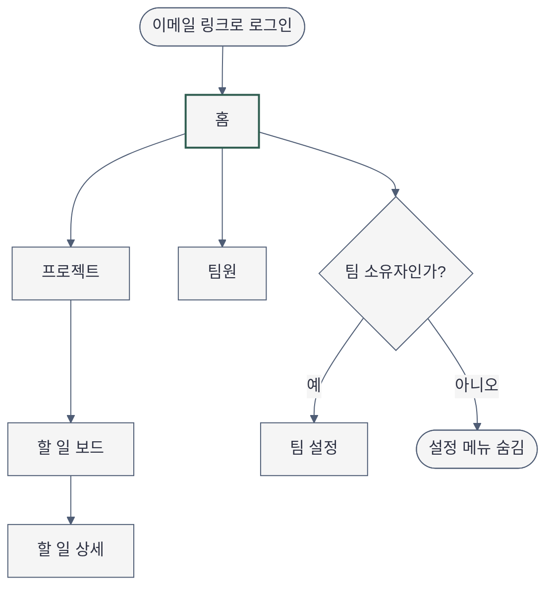
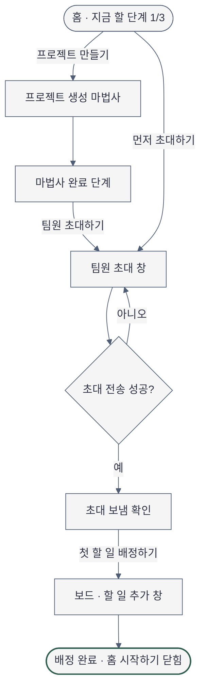

# Sitemap — 플로우보드 홈과 첫 실행 흐름

- 날짜: 2026-11-04 · 관련: [brief](2026-11-04-brief-home.md), [experience](2026-11-04-experience-home.md), [layout](2026-11-04-layout-home.md)
- 이번 요청이 설계하는 화면은 **홈(`home`)** 하나다. 다른 화면은 홈에서 이어지는 목적지로만 정하고, 내부 구성은 각 화면 작업에서 정한다.
- 화면 이름(ID)은 `Object Flows`·`Scenario Facts`·와이어프레임이 같은 값을 쓴다.

## 1. 화면 목록과 단일 임무

| ID | 화면 | 단일 임무 | 이번 설계 범위 |
|---|---|---|---|
| `home` | 홈 | 지금 할 다음 한 단계를 보여 주고 시작시킨다. 데이터가 생기면 같은 자리에 내 할 일·프로젝트·팀원 상태 | **설계** |
| `project-wizard` | 프로젝트 생성 마법사 | 첫 프로젝트를 만든다 | 목적지만 |
| `project-created` | 마법사 완료 단계 | 만든 프로젝트를 확인하고 다음 단계(팀원 초대)로 넘긴다 | 목적지만 |
| `invite-dialog` | 팀원 초대 창(현재 화면 위 대화상자) | 이메일 주소를 넣어 초대를 보낸다 | 목적지만 |
| `invite-sent` | 초대 보냄 확인(대화상자의 완료 모습) | 보낸 주소와 다음 단계를 알린다 | 목적지만 |
| `members` | 팀원 | 팀원과 초대 상태를 보고 다시 보내기·취소한다 | 목적지만 |
| `board` | 할 일 보드 | 프로젝트의 할 일을 상태별로 보고 옮긴다 | 목적지만 |
| `task-form` | 할 일 추가 창 | 할 일 이름·담당·마감을 정해 배정한다 | 목적지만 |
| `task-assigned` | 배정 완료 알림(보드 위 알림 + 홈 3단계 완료) | 배정이 끝났음을 알리고 홈 시작하기를 닫는다 | 목적지만 |
| `task-detail` | 할 일 상세 | 할 일을 고치고 지우고 댓글을 단다 | 목적지만 |
| `project-settings` | 프로젝트 이름·보관 창(보드 헤더 메뉴) | 프로젝트 이름을 바꾸거나 보관한다 | 목적지만 |
| `settings` | 팀 설정 | 팀 이름·팀원 권한을 바꾼다(팀 소유자만) | 목적지만 |

`invite-dialog`·`task-form`은 지금 화면을 벗어나지 않고 입력하는 일이라 별도 페이지가 아니라 대화상자다(korean-mobile-app.md 1절의 "바텀 시트" 기준을 데스크톱 대화상자에 적용).

## 2. 내비게이션

- **전역(좌측 사이드바)**: 홈 · 프로젝트 · 팀원 · 설정. 활성 항목 1개만 강조. 설정은 팀 소유자에게만 표시(역할 변형은 layout 4절).
- **2차**: 프로젝트 안에서 보드 · 할 일 상세. 홈에는 2차 내비가 없다.
- **페이지 내 앵커**: 없음(홈은 한 화면 높이 안에서 끝남).
- **primary action과 현재 위치 신호**: 홈의 primary는 "지금 할 단계"의 버튼 1개. 현재 위치는 사이드바 "홈" 활성 + 단계 목록의 "지금 할 단계" 1개.
- 사이드바 anatomy의 "내비 5~7개" 기본값보다 적은 4개다. 화면을 채우려고 항목을 늘리지 않는다.

## 3. 전역 구조 (개요)

## 4. 첫 실행 흐름 (팀 리더, 데이터 0건 → 시작하기 완료)

노드 9개(개요는 9개, 흐름은 9개). 실패 분기는 초대 전송 하나만 그렸다. 홈 자체의 loading·error 상태는 experience `States`에 있다.

## 5. 흐름 고리 (Object Flows)

| Object | Create | View | Edit | After |
|---|---|---|---|---|
| 프로젝트 | home → project-wizard | board | project-settings(보드 헤더 메뉴의 이름·보관 창) | project-created (프로젝트를 만들었어요 + 다음 단계) |
| 팀원 초대 | home → invite-dialog | members | members(다시 보내기·초대 취소) | invite-sent (초대 보냄 확인) |
| 할 일 | board → task-form | task-detail | task-detail(고치기·지우기) | task-assigned (배정 완료 알림 + 홈 3단계 완료) |

빈 칸을 채우며 화면 목록에 더한 것: `project-created`, `invite-sent`, `task-assigned`(After 칸이 비어 있었음), `invite-dialog`(초대 Create가 설정 메뉴 안에만 있었음 — P2), `project-settings`(프로젝트 Edit 자리가 없었음).

- 프로젝트의 Edit을 팀 설정(`settings`)이 아니라 보드 헤더 메뉴의 `project-settings` 창에 둔 것은 권장안이다(팀 설정은 member에게 숨겨지므로). 확정은 보드 화면 설계 몫이며 experience `Open Decisions`(structure)에 올렸다.
- `Edit` 칸의 팀원 내보내기는 팀 소유자만 한다(spec 금지 행동: 팀원 "팀원 내보내기").

## 6. 검증

- Mermaid 문법: 이 환경에 렌더러(mmdc)가 없어 **NOT RUN**. 노드 ID는 영문 camelCase로 고정, 라벨은 모두 따옴표, 분기 출구마다 라벨을 달았다.
