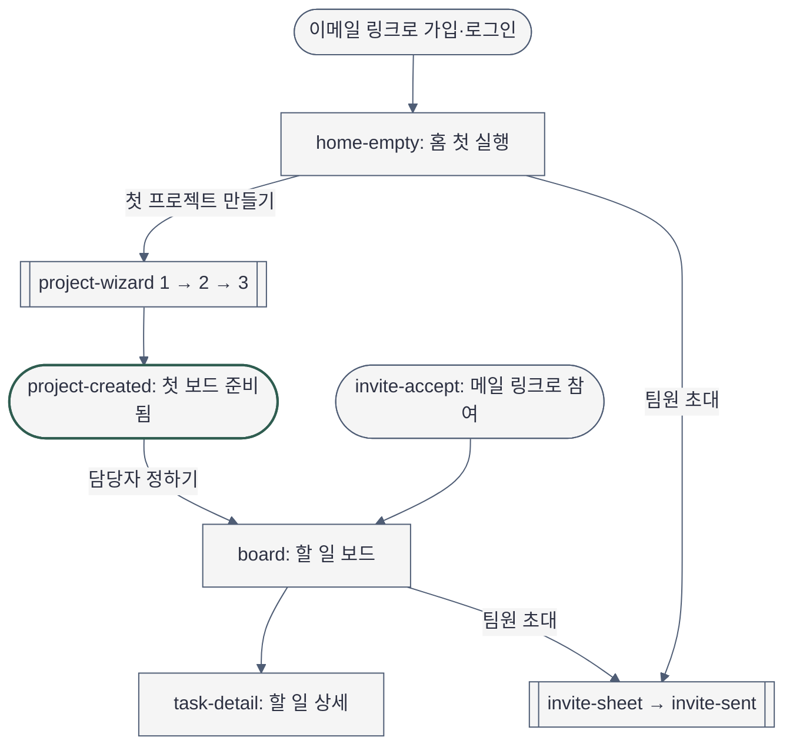
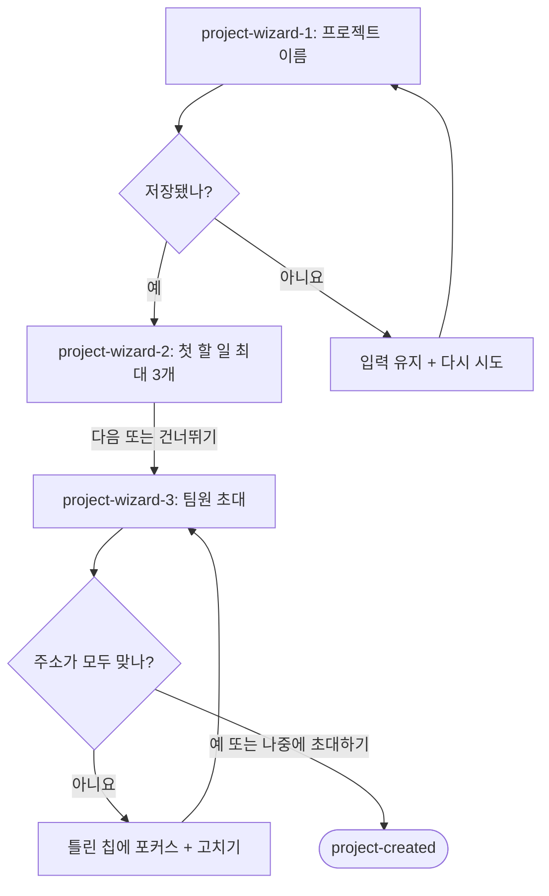
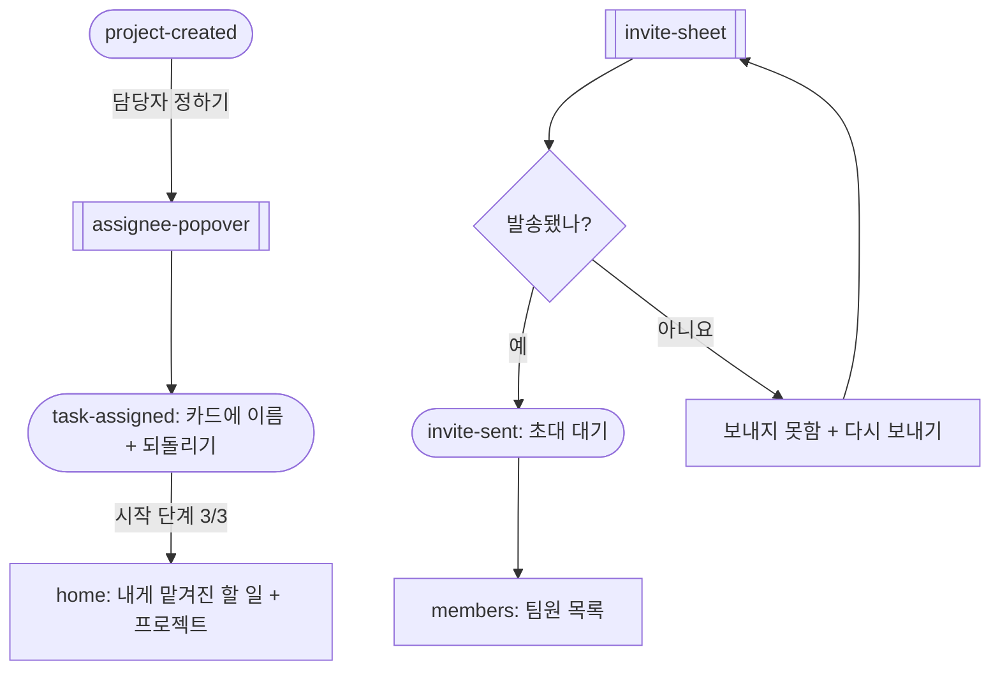
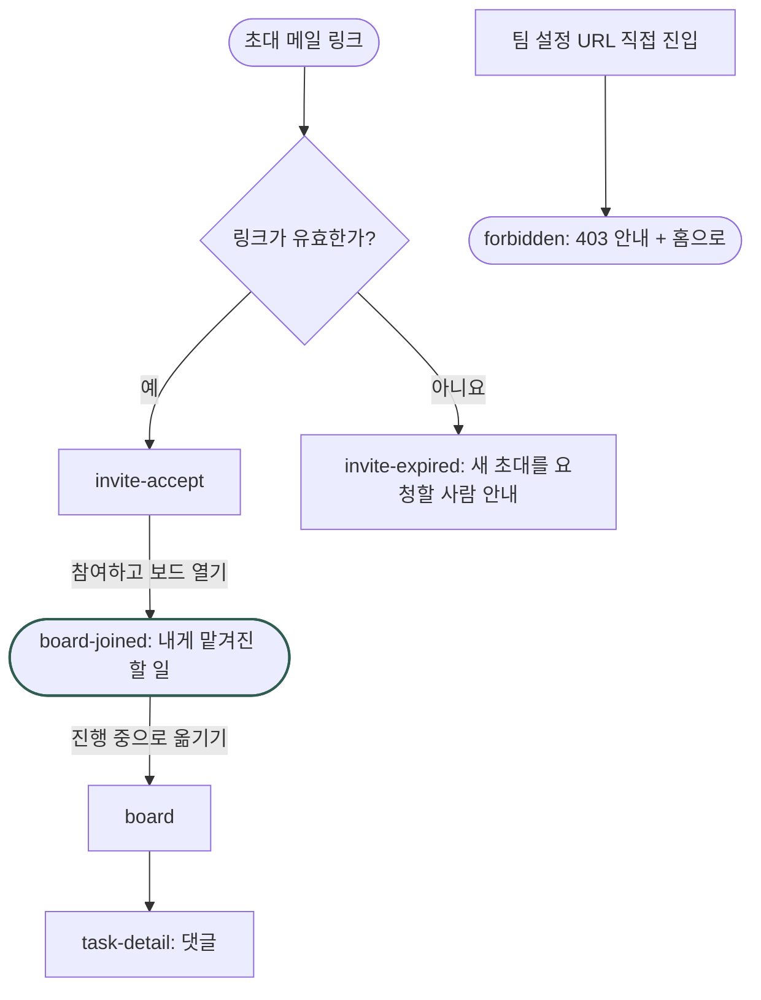

# Sitemap — 플로우보드 첫 실행 경험

- 작성: 2026-11-04 · Aphrodite Phase 2-1
- 입력: `2026-11-04-brief-projectflow.md`, spec 시스템 역할 표(`owner`·`member`, 둘 다 `공용 권한차등`)
- Mermaid 문법: `MODULE_SKILL[mermaid-diagrams]` = `D:\git\claude-code-agent-customizations\skills\mermaid-diagrams\SKILL.md`(frontmatter `name: mermaid-diagrams` 확인)를 직접 읽고 작성. 사람용 밀도 예산(노드 9개 이하)에 맞춰 개요 1장 + 상세 3장으로 나눔. 렌더러(mmdc)가 없어 **문법 검증 NOT RUN**.

## 1. 흐름 고리 — 대상마다 시작과 끝 (korean-mobile-app.md 1절)

빈 칸을 채우며 화면 목록에 더한 것: `project-created`(프로젝트의 끝), `invite-sent`(초대의 끝), `task-assigned`(맡기기의 끝), `board-joined`(참여의 끝), `comment-posted`(댓글의 끝), `invite-expired`·`forbidden`(실패 화면). Experience Contract `## Object Flows`가 정본이다.

| Object | Create | View | Edit | After |
|---|---|---|---|---|
| 프로젝트 | home-empty → project-wizard-1 | board | project-settings | project-created (첫 보드 준비됨) |
| 팀원 초대 | project-wizard-3 · invite-sheet | members | invite-resend (다시 보내기·초대 취소) | invite-sent (사람별 발송 결과) |
| 할 일 | project-wizard-2 · board-add-row | task-detail | task-detail-edit (고치기·지우기·상태 옮기기) | task-added (열 끝에 새 카드) |
| 할 일 맡기기 | assignee-popover | board-card-assignee | assignee-popover-change (바꾸기·빼기) | task-assigned (카드에 이름 + 되돌리기 토스트) |
| 초대 수락(팀원) | invite-accept | board | n/a — 수락 뒤 되돌리기·팀 나가기는 spec MVP 범위에 없음 | board-joined (참여 완료 + 내게 맡겨진 할 일) |
| 댓글 | task-detail-comment-input | task-detail-comments | n/a — spec 역할 표에 댓글 고치기·지우기 없음 | comment-posted (목록 끝 새 댓글) |

## 2. 화면 목록 — 각 화면의 단일 임무

| ID | 화면 | 단일 임무 | 보는 역할 | Primary action | 현재 위치 신호 |
|---|---|---|---|---|---|
| auth-link | 이메일 링크 가입·로그인 | 계정과 팀 이름 만들기(설계 범위 밖 진입점, Open Decisions) | 전원 | 링크 메일 받기 | — |
| home-empty | 홈 · 첫 실행(프로젝트 0개) | 첫 행동 하나를 고르게 함 | owner | 첫 프로젝트 만들기 | 사이드바 "홈" |
| home | 홈 · 데이터 있음 | 내게 맡겨진 할 일과 프로젝트로 돌아가게 함(KPI 없음) | owner·member | 맡은 할 일 열기 | 사이드바 "홈" |
| project-wizard-1 | 프로젝트 만들기 1/3 | 프로젝트 이름 정하기 → 저장 | owner·member(권장) | 다음: 첫 할 일 적기 | 스텝 1 강조 |
| project-wizard-2 | 프로젝트 만들기 2/3 | 첫 할 일 최대 3개 적기 | 〃 | 다음: 팀원 초대 | 스텝 2 강조 |
| project-wizard-3 | 프로젝트 만들기 3/3 | 팀원 이메일로 초대 | 〃 | 초대 보내고 보드 열기 | 스텝 3 강조 |
| project-created | 보드 · 완료 모습 | 만든 결과 확인 + 마지막 단계(맡기기) 안내 | owner | 담당자 정하기 | 사이드바 프로젝트 이름 |
| board | 할 일 보드 | 할 일 상태를 한눈에 보고 옮기기 | owner·member | (열 끝) + 할 일 추가 | 사이드바 프로젝트 이름 |
| board-joined | 보드 · 참여 직후 | 팀원이 자기 할 일을 바로 시작 | member | 진행 중으로 옮기기 | 사이드바 프로젝트 이름 |
| task-detail | 할 일 상세(우측 패널 / 모바일 전체 시트) | 설명·담당자·마감·댓글 | owner·member | 댓글 남기기 | 보드 카드 선택 상태 |
| invite-sheet | 팀원 초대 시트 | 이메일로 초대 보내기 | owner·member(권장) | 초대 보내기 | 시트 제목 |
| members | 팀원 목록 | 누가 들어왔는지·초대 상태 확인 | owner·member | (owner) 다시 보내기 | 사이드바 "팀원" |
| project-settings | 프로젝트 설정 | 이름 바꾸기·보관 | owner | 저장 | 보드 헤더 메뉴 |
| team-settings | 팀 설정 | 팀 이름·팀원 내보내기 | owner(member 숨김) | 저장 | 사이드바 "팀 설정" |
| invite-accept | 초대 수락 | 누가 어디로 불렀는지 확인 후 참여 | 초대받은 사람 | 참여하고 보드 열기 | — |
| invite-expired | 초대 만료 | 새 초대를 누구에게 요청할지 알려 줌 | 초대받은 사람 | (안내만) 홈으로 | — |
| forbidden | 권한 없음(403, 라우팅 결과) | 막힌 이유와 돌아갈 곳 | member | 홈으로 | — |

바텀 시트·팝오버(새 화면 아님 — 1절 "지금 화면을 벗어나지 않고 고르는 일"): `assignee-popover`(담당자 고르기), 마법사 "나가기" 확인.

## 3. 내비게이션

- 전역(데스크톱 좌측 사이드바): 팀 이름 → 홈 · 팀원 → 프로젝트 목록(첫 실행은 "아직 없음" + "+ 새 프로젝트") → 하단 고정: "팀원 초대"(outline) · 팀 설정(owner만) · 사용자
- 전역(모바일): 상단 바(현재 화면 제목 + "초대") + 하단 탭 3개(홈 · 프로젝트 · 팀원)
- 2차: 보드 헤더 — 프로젝트 이름, 팀원 상태 요약("초대 대기 2명"), 프로젝트 설정 메뉴(owner)
- 페이지 내 앵커: 없음
- 마법사는 사이드바 없이 집중 화면(상단에 "나가기"만). 1단계 저장 뒤 나가면 보드로 간다.

## 4. 사이트맵 — 개요

## 5. 상세 A — 마법사와 실패 복구

## 6. 상세 B — 맡기기와 초대 결과

## 7. 상세 C — 팀원 경로와 권한

