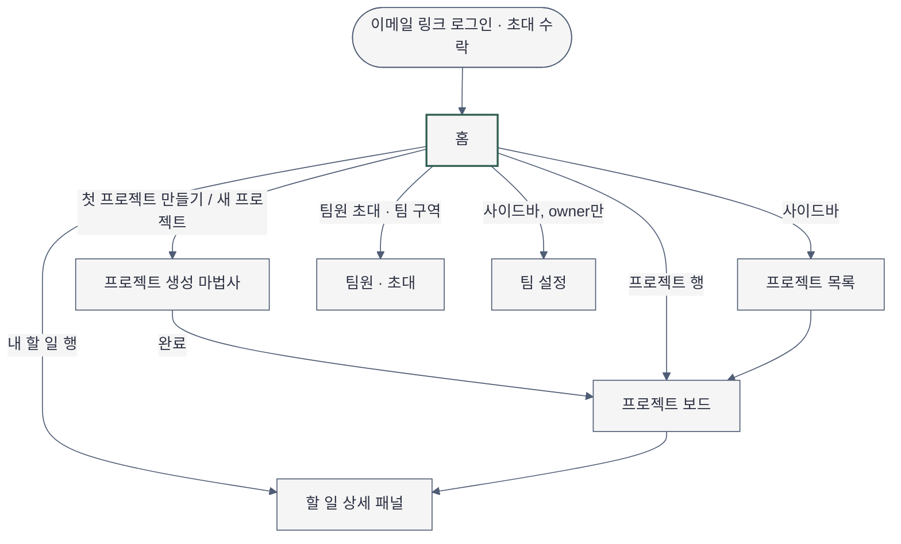
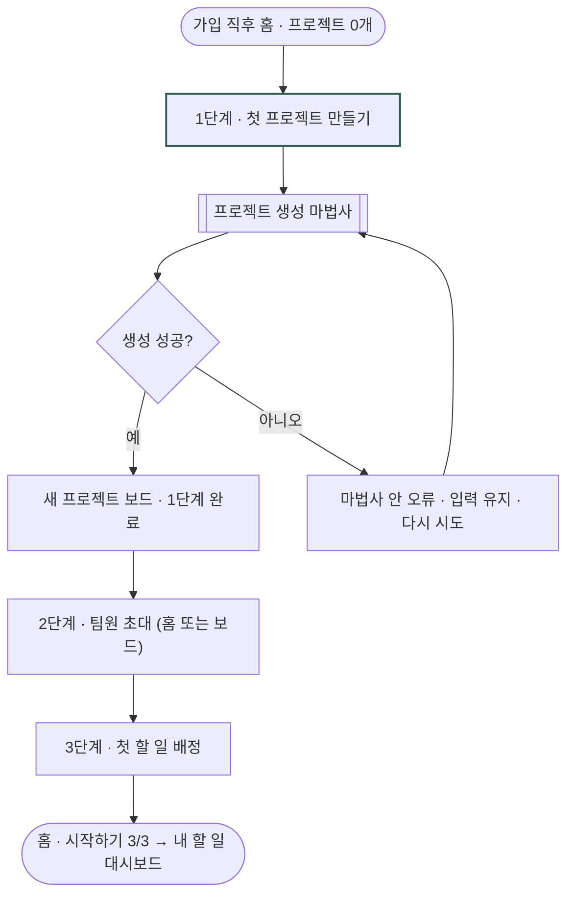

# Sitemap — 플로우보드 (홈 중심)

- 작성일: 2026-11-04 · Phase 2-1, 2-2
- 근거: `docs/plan/projectflow/spec.md`(섹션 01-onboarding, 02-board, 역할 owner·member), `docs/athena/projectflow.md`(MVP 3기능), `src/pages/Home.tsx`(현재 구현된 화면은 홈 하나)
- 표기: 아래 화면 중 실제 코드가 있는 것은 `홈`뿐입니다. 나머지는 spec의 MVP 범위에서 도출한 계획 IA이며 경로(URL)는 구현 파이프라인이 정합니다.
- 문법: `MODULE_SKILL[mermaid-diagrams]` 규칙(flowchart TD, 안정 노드 ID, 인용 라벨, 노드 9개 이하, 액센트 1~2개). mmdc 렌더러가 없어 **문법 렌더 검증은 NOT RUN**.

## 1. 페이지 목록과 단일 임무

| ID | 화면 | 단일 임무 | 진입 | 역할 |
|---|---|---|---|---|
| `login` | 이메일 링크 로그인 · 초대 수락 | 메일 링크로 들어와 팀에 합류 | 가입·초대 메일 | owner, member |
| `home` | 홈 | 내 할 일과 팀 현황을 보고 다음 행동 하나를 고름. 프로젝트 0개면 첫 보드까지 안내 | 로그인 직후, 사이드바 `홈` | owner, member |
| `wizard` | 프로젝트 생성 마법사 | 첫(새) 프로젝트를 만들고 보드를 연다 | 홈 "첫 프로젝트 만들기"·"새 프로젝트", 프로젝트 목록 | owner (member는 미확인) |
| `board` | 프로젝트 보드 | 할 일을 열(할 일·진행 중·완료)로 옮기고 배정 | 마법사 완료, 홈·목록의 프로젝트 행 | owner, member |
| `task` | 할 일 상세 (보드 위 패널) | 담당자·마감·댓글 처리 | 보드 카드, 홈 내 할 일 행 | owner, member |
| `projects` | 프로젝트 목록 | 팀의 프로젝트를 찾아 보드로 이동 | 사이드바 `프로젝트` | owner, member |
| `team` | 팀원 · 초대 | 팀원·초대 대기 확인, 초대 재전송·취소 | 사이드바 `팀원`, 홈 팀 구역 | owner (member는 읽기전용) |
| `settings` | 팀 설정 | 팀 이름·권한 등 설정 | 사이드바 `설정` | owner만 (member 금지: 팀 설정 변경) |

## 2. 내비게이션

- 전역(데스크톱 좌측 사이드바, DESIGN.md "좌측 내비"): 팀 이름 → `홈` · `프로젝트` · `팀원` · `설정`(owner만) → 하단 사용자·역할.
- 현재 위치 신호: 사이드바 활성 항목 1개 + 페이지 `h1`.
- 2차 내비: 보드 상단의 프로젝트 이름·열 탭(보드 설계 범위, 이번 작업 밖).
- 페이지 내 앵커: 홈 구역 제목(내 할 일·프로젝트·팀) — 별도 앵커 메뉴는 두지 않음.
- 모바일: 사이드바 → 상단 바(팀 이름 + `메뉴` 버튼 → 내비 시트)로 대체.
- 홈의 primary action: 프로젝트 0개 owner = "첫 프로젝트 만들기", 사용 중 owner = "새 프로젝트", member = 솔리드 버튼 없음(할 일 체크·보드 이동이 주 행동).

## 3. 사이트맵

## 4. 과업 흐름 (Phase 2-2)

기능형 화면이므로 `입력 → 처리 → 진행 상태 → 결과 → 오류 회복` 순서로 설계합니다.

### 4-1. 새 owner: 첫 보드까지

| 단계 | 입력 | 처리 | 진행 상태 | 결과 | 오류 회복 |
|---|---|---|---|---|---|
| 1. 프로젝트 만들기 | "첫 프로젝트 만들기" 클릭 | 마법사로 이동 | 마법사 자체 진행 표시(마법사 설계 범위) | 새 보드가 열림. 홈 복귀 시 1단계 체크, "1 / 3 완료" | 마법사 안에서 입력을 지우지 않고 다시 시도. 홈은 그대로 0/3 |
| 2. 팀원 초대 | 홈 2단계의 이메일 칸 + "초대 보내기" | 이메일 외부 API로 초대 발송 | 버튼 안 "보내는 중…" (300ms 이후) | 같은 자리에 "boram.kim@onkyeol.kr 님에게 초대 메일을 보냈습니다", 팀 구역에 "초대 대기 1명", 2단계 체크 | 형식 오류: 입력 아래 "이메일 형식을 확인해 주세요. 예: name@company.com" / 발송 실패: "초대 메일을 보내지 못했습니다. 잠시 후 다시 보내 주세요." + "다시 보내기" — 입력값 유지 |
| 3. 첫 할 일 배정 | 프로젝트가 생기면 열리는 "할 일 배정하기" | 해당 보드로 이동해 할 일 추가·담당자 지정 | 보드 설계 범위 | 홈 3단계 체크 → 진행판이 사라지고 사용 중 홈으로 | 프로젝트가 없으면 버튼 `비활성` + "프로젝트를 만들면 열립니다" |

### 4-2. 사용 중: 오늘 할 일 처리

| 단계 | 입력 | 처리 | 진행 상태 | 결과 | 오류 회복 |
|---|---|---|---|---|---|
| 현황 확인 | 홈 진입 | 내 할 일 요약 조회 | 구역별 스켈레톤(300ms 이후) | 현황 3칸 + 마감 순 목록 | 구역별 오류 + "다시 시도". 다른 구역은 유지 |
| 걸러 보기 | 현황 칸(예: "마감 지남 1") 클릭 | 목록 필터 | 즉시 | 해당 할 일만 남고 칸이 눌린 상태 | 다시 누르면 해제 |
| 완료 처리 | 할 일 체크 | 상태 변경 | 체크 즉시 반영(낙관적) | 행 흐려짐 + 알림 "완료로 표시했습니다 · 되돌리기" | 실패 시 체크 되돌림 + "완료로 바꾸지 못했습니다. 다시 시도해 주세요." |
| 자세히 | 할 일 제목 클릭 | 해당 보드의 할 일 상세 패널 | 페이지 이동 | 할 일 상세 | 권한 없는 할 일은 목록에 나오지 않음 |

### 4-3. member 첫 진입

| 상황 | 사용자가 보는 것 | 다음 행동 |
|---|---|---|
| 팀에 프로젝트가 있고 내 할 일 0개 | "아직 나에게 배정된 할 일이 없습니다." + 프로젝트 목록 | 프로젝트 행 → 보드 |
| 팀에 프로젝트가 아직 없음 (owner가 1단계 전에 초대한 경우) | "아직 팀에 프로젝트가 없습니다. 한지우 님이 프로젝트를 만들면 여기에 표시됩니다." + 팀 명단 | 기다림. 이 상태는 4-1에서 초대를 1단계 전에 허용했기 때문에 생김(미해결 질문 3) |
