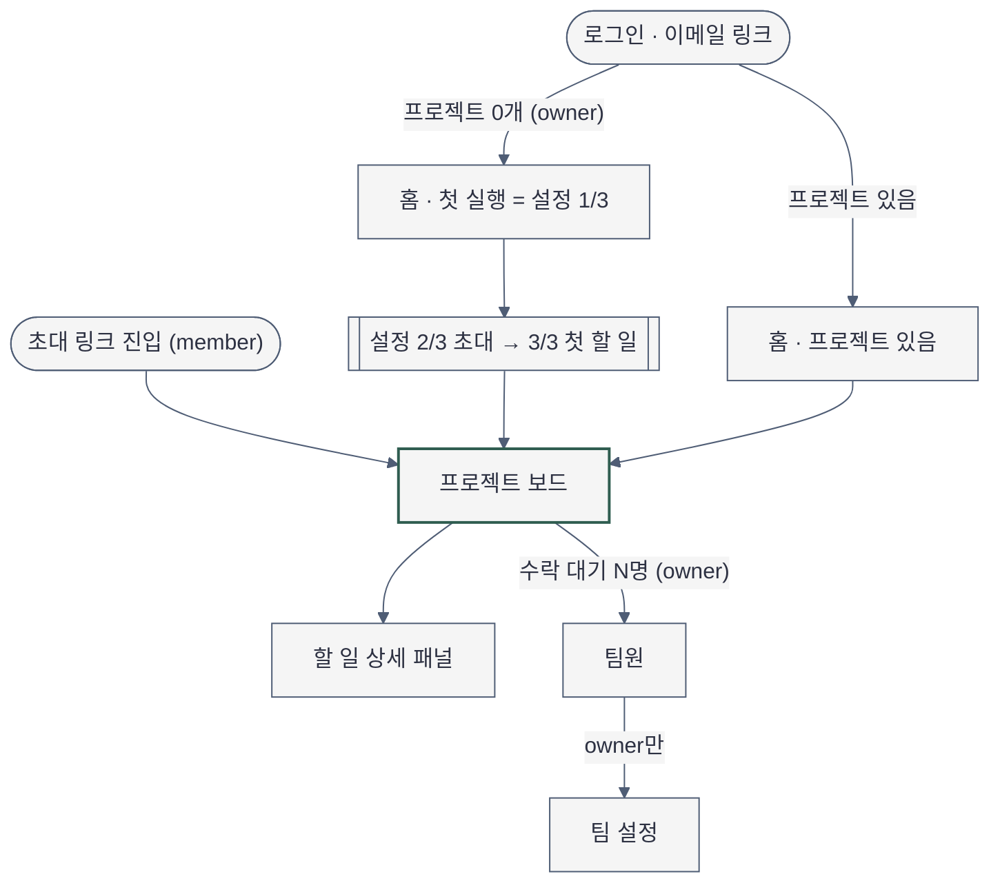
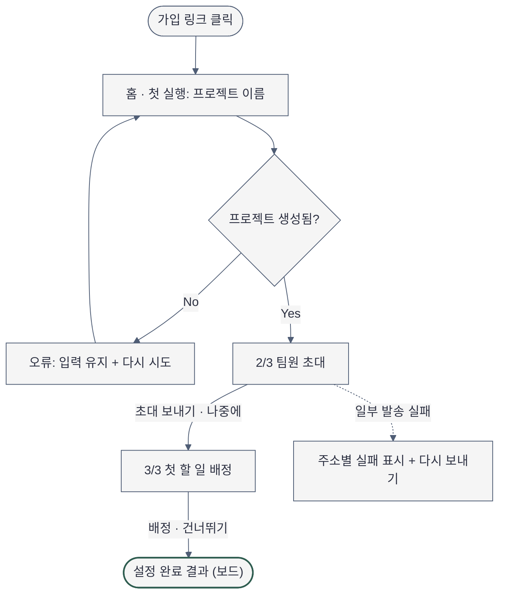
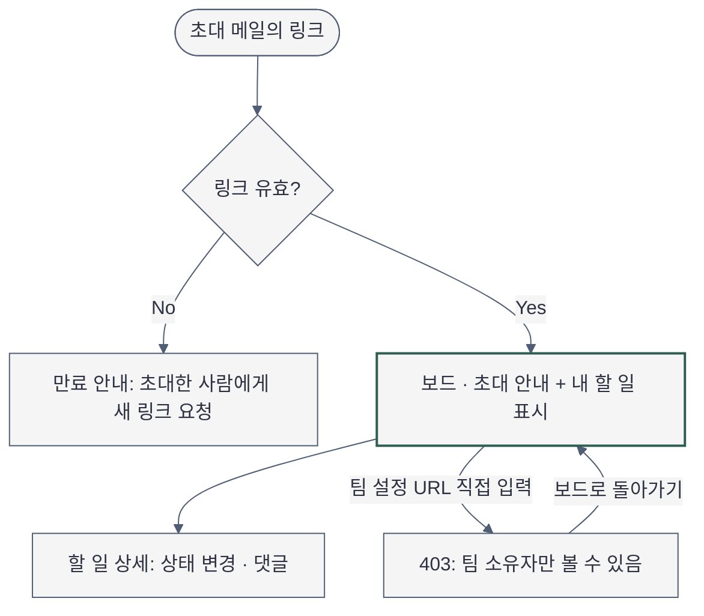

# Sitemap — 플로우보드 MVP (첫 실행 중심)

- 작성일: 2026-11-04 · Phase 2-1 · Source Mode: product-derived
- 근거: `docs/plan/projectflow/spec.md`(목표·P1·P2·역할 표), `interview.md`(MVP 포함·제외), `docs/athena/projectflow.md`(삭제 권고)
- 역할 ID는 spec 시스템 역할 표 그대로: `owner`(팀 소유자), `member`(팀원). 두 역할 모두 `공용 권한차등`이라 역할 전용 화면을 따로 두지 않는다.
- 다이어그램 문법: `MODULE_SKILL[mermaid-diagrams]` = `D:\git\claude-code-agent-customizations\skills\mermaid-diagrams\SKILL.md` 직접 읽음. 렌더러 검증 결과는 문서 끝에 기록.

## 화면 목록과 단일 임무

| ID | 화면 | 단일 임무 | primary action (정확한 문구) | 역할 |
|---|---|---|---|---|
| `auth-link` | 로그인 | 이메일로 로그인 링크 받기 | "로그인 링크 받기" | 비로그인 |
| `home-first-run` | 홈 · 첫 실행 (프로젝트 0개) | 첫 프로젝트 이름을 정하고 만든다 (= 설정 1/3단계) | "프로젝트 만들기" | owner |
| `setup-invite` | 설정 2/3 · 팀원 초대 | 함께 쓸 팀원에게 초대 메일을 보낸다 | "초대 보내기" (보조: "나중에 초대하기") | owner |
| `setup-task` | 설정 3/3 · 첫 할 일 | 첫 할 일을 만들고 담당자를 정한다 | "할 일 배정하기" (보조: "건너뛰고 보드 보기") | owner |
| `setup-done` | 설정 완료 결과 | 세 단계의 결과(프로젝트·초대·첫 할 일)를 보드 위에서 확인한다 | "+ 할 일 추가" (보드 primary 유지) | owner |
| `project-board` | 프로젝트 보드 | 할 일을 상태 열에서 보고 옮긴다 | "+ 할 일 추가" | owner·member |
| `task-detail` | 할 일 상세 (보드 우측 패널) | 할 일 하나의 담당·상태·댓글을 처리한다 | "댓글 남기기" | owner·member |
| `members` | 팀원 | 팀원과 초대 상태를 확인하고 초대를 관리한다 | "팀원 초대" (owner만) | owner (member는 읽기전용) |
| `team-settings` | 팀 설정 | 팀 이름 등 팀 설정을 바꾼다 | "변경 사항 저장" | owner (member는 진입 차단 403) |
| `invite-accept` | 초대 링크 진입 | 초대 링크를 확인하고 해당 보드로 보낸다 | 자동 이동 / 만료 시 안내 | member |
| `home` | 홈 · 프로젝트 있음 | 내 프로젝트로 돌아가고, 미완료 설정을 이어 한다 | "설정 이어서 하기" (미완료 시) / 없으면 프로젝트 선택 | owner·member |

**넣지 않는 화면**: 팀 성과 KPI 대시보드, 시간 추적, 리포트 내보내기, Slack 연동 설정 — interview Soft Gate 3 "제외"와 athena 삭제 권고. 홈은 지표 화면이 아니라 "다음에 할 일" 화면이다.

## 내비게이션

| 구분 | 데스크톱 | 비고 |
|---|---|---|
| 전역 (좌측 내비, DESIGN.md "좌측 내비 + 본문 1열") | 팀 이름 → 홈 → 프로젝트(목록) → 팀원 → 팀 설정(owner만) → 하단: "팀원 초대"(owner만, 보조 버튼) · 내 계정 | 현재 위치 = 활성 항목 1개만 강조 |
| 2차 (보드 헤더) | 프로젝트 이름 → 참여 인원 → "수락 대기 N명"(팀원 화면 링크, owner만) → "+ 할 일 추가"(primary) | P2: 초대 상시 진입점은 사이드바 "팀원 초대". 보드 헤더에는 버튼을 겹쳐 두지 않고 초대 상태 링크만 둠(와이어프레임 관찰 후 결정) |
| 설정 단계(마법사) | 전역 내비는 유지하되 단계 표시(1/3·2/3·3/3)가 본문 상단의 현재 위치 신호 | 마법사 중에도 홈·팀원으로 나갈 수 있음 — 나가도 1단계 이후 프로젝트는 남음 |
| 페이지 내 앵커 | 없음 | |

## 1. 개요 사이트맵

## 2. 첫 실행 과업 흐름 (owner)

`입력 → 처리 → 진행 상태 → 결과 → 오류 회복` 순서. 상세 상태 표는 Experience Contract `## States`.

- 발송 실패는 2단계를 막지 않는다(점선). 실패한 주소는 완료 결과와 `members`에 "발송 실패"로 남고 거기서 다시 보낸다.
- 2·3단계 어디서든 홈으로 나가면 `home`에 "설정 이어서 하기 (2/3)"가 보인다.

## 3. 팀원 진입 흐름 (member)

## 검증 기록

- 2026-11-04: `mmdc`는 설치돼 있지 않음. 대신 headless Chromium(Playwright, chromium-1234)에서 CDN `mermaid@11.4.1`의
  `mermaid.render()`로 세 블록을 실제 렌더 → block 1·2·3 모두 SVG 생성 성공(문법 오류 0). 개요 edge 라벨을
  "수락 대기 N명 (owner)"로 바꾼 뒤 같은 방법으로 재검증해 다시 3블록 모두 성공.
- 노드 수: 개요 9 · 첫 실행 9 · 팀원 진입 6 (모듈 밀도 예산 9 이하). 액센트는 블록마다 결과 노드 1개.
