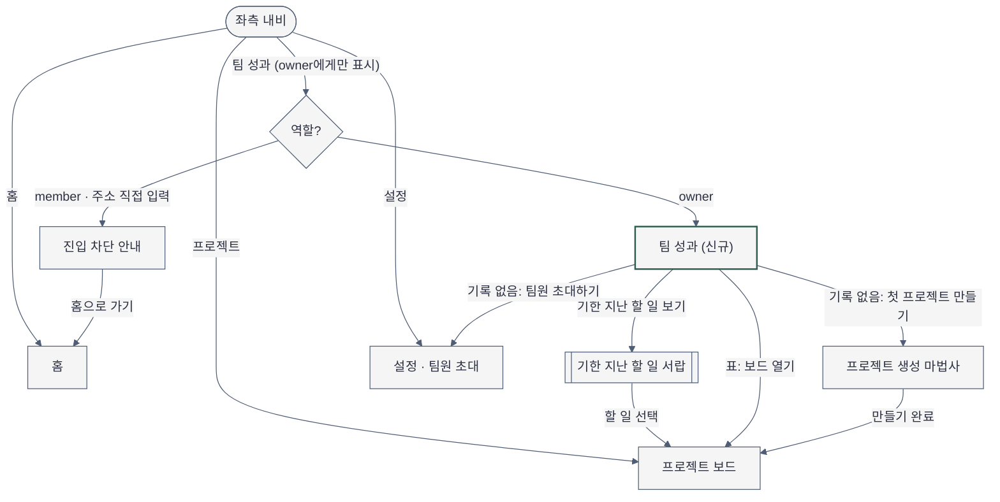

# Sitemap — 팀 성과 탭 추가

- 작성일: 2026-11-04 · Phase 2-1
- 근거: `docs/plan/projectflow/spec.md`(MVP: 프로젝트 생성 마법사·팀원 초대·할 일 보드, 역할 owner/member), `DESIGN.md`("좌측 내비 + 본문 1열")
- 주의: 코드에는 `src/pages/Home.tsx`만 있습니다. 홈 외 화면·좌측 내비는 spec에서 가정한 구조이며, 이번 변경은 `팀 성과` 1개 화면과 그 안의 서랍 1개를 더하는 것입니다.

## 화면 목록과 단일 임무

| 화면 | 경로(가정) | 단일 임무 | primary action | 현재 위치 신호 | 이번 변경 |
|---|---|---|---|---|---|
| 홈 | `/` | 오늘 할 일과 첫 프로젝트 시작 | (기존) | 내비 `홈` 활성 | 없음 |
| 프로젝트·보드 | `/projects/:id` | 할 일을 옮기고 처리 | (기존) | 내비 `프로젝트` 활성 | 없음. 서랍·표에서 들어오는 목적지 |
| 프로젝트 생성 마법사 | `/projects/new` | 첫 프로젝트 만들기 | (기존) | 단계 표시 | 없음. 기록 없음 상태에서 들어오는 목적지 |
| 설정 | `/settings` | 팀 정보·팀원 초대 등 값 바꾸기 | (기존) | 내비 `설정` 활성 | 없음. 기록 없음 상태의 `팀원 초대하기`가 팀원 초대 구역으로 직접 이동 |
| **팀 성과** | `/team/performance` | 팀이 기한 안에 일을 끝내는지 보고 밀린 일로 이동 | `기한 지난 할 일 보기` (기록 없음 상태에서는 다음 활성화 단계 1개) | 내비 `팀 성과` 활성 + 페이지 제목 | **신규, owner 전용** |
| 기한 지난 할 일 서랍 | `/team/performance?panel=overdue` | 밀린 할 일 6건을 누가·며칠 밀렸는지와 함께 보고 하나를 엶 | 항목 선택 → 보드의 그 할 일 | 서랍 제목 `기한 지난 할 일 N건` | **신규**(별도 화면 아님) |
| 진입 차단 안내 | `/team/performance` (member) | 이 화면이 owner 전용임을 알리고 돌려보냄 | `홈으로 가기` | 제목 문구 | **신규 상태** |

## 내비게이션

- 전역(좌측 내비, 데스크톱): 워크스페이스 이름 → `홈` · `프로젝트` → 구분선 → `팀 성과` · `설정` → 하단 사용자·역할
  - `팀 성과`는 `설정` 바로 위 형제 항목(요청의 "설정 화면 옆"). 설정 안의 세로 탭으로 넣지 않은 이유: 설정은 값을 바꾸는 화면, 팀 성과는 읽고 이동하는 화면이라 임무가 섞임
  - member 내비에는 `팀 성과` 항목이 없음(숨김)
- 모바일: 좌측 내비를 `☰` 서랍으로 대체. 항목 순서·노출 규칙 동일
- 2차 내비: 없음. 화면 안의 조작은 기간 선택(`최근 4주` / `최근 12주`), `지표 정의 보기`, `표로 보기`, 표 정렬
- 페이지 내 앵커: 없음(한 화면 안에 KPI → 추세 → 표가 순서대로 있음)

## 사이트맵

`MODULE_SKILL[mermaid-diagrams]`(`D:\git\claude-code-agent-customizations\skills\mermaid-diagrams\SKILL.md`)의 문법·Editorial Style Rules로 작성: `flowchart TD`, 노드 9개, 도형으로 타입 구분, 분기 레이블 필수, 액센트는 신규 화면 1개에만.

- 액센트 stroke는 `DESIGN.md`의 `primary`(#2F5D50) 토큰을 사용(모듈 규칙: "프로젝트 DESIGN.md 토큰이 있으면 그것을")
- 문법 렌더 검증: `NOT RUN` — Mermaid CLI(`mmdc`)가 이 환경에 설치돼 있지 않고, 이 실행은 새 의존성을 설치하지 않음

## 흐름 고리 (여러 화면 모바일 앱 전용 절)

`NOT APPLICABLE` — 사용자가 이 화면에서 무언가를 만들거나 신청하지 않는 읽기·이동 화면이고, 대상 앱도 여러 화면 모바일 앱이 아님
