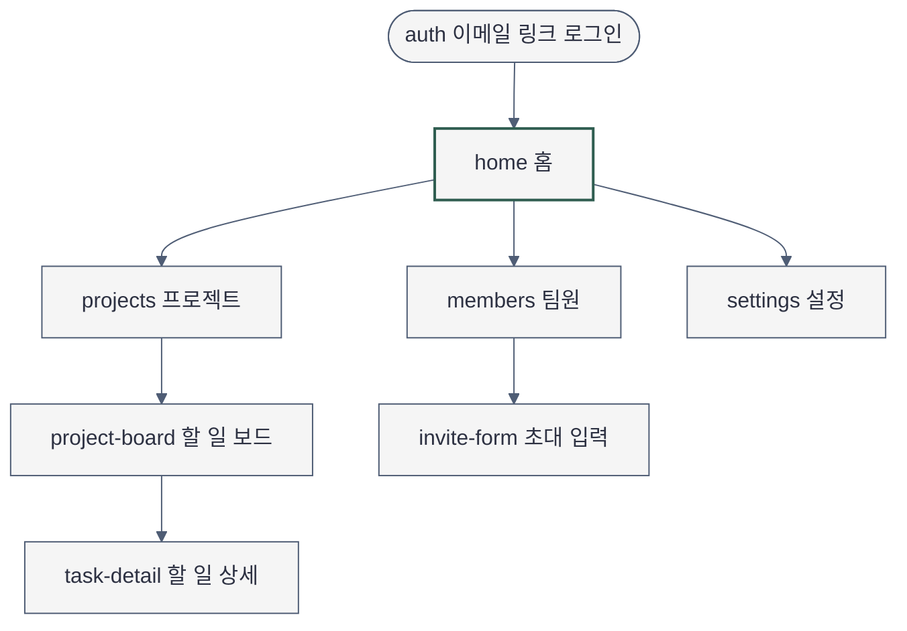
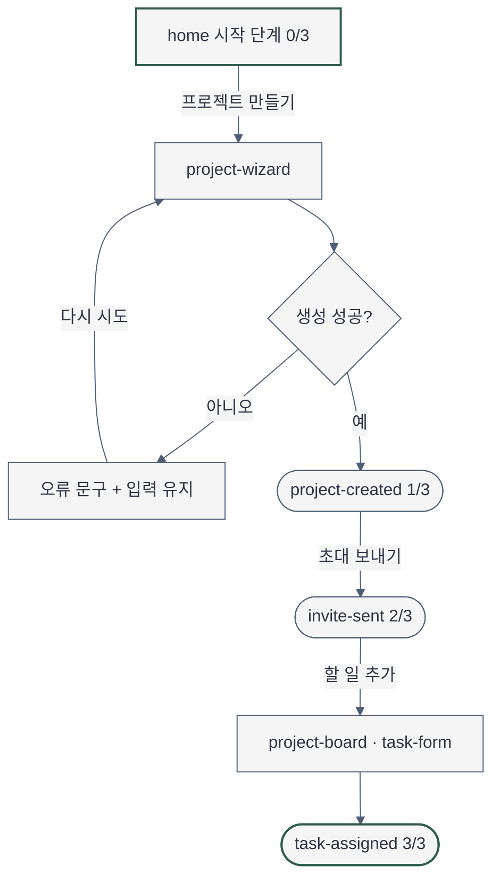

# 사이트맵 — 플로우보드 (홈 첫 실행 기준)

- 작성: 2026-11-11 · 계층 판정: strategy (brief 참조)
- 이번 요청이 설계하는 화면은 `home` 하나입니다. 나머지는 `home`의 주 과업이 끝까지 이어지는지 확인하려고 이름과 임무만 적었고,
  내용은 `01-onboarding`·`02-board` 섹션이 정합니다.

## 화면 목록

| ID | 화면 | 단일 임무 | 근거 |
|---|---|---|---|
| `auth` | 이메일 링크 로그인 | 들어온다 | spec 기존 환경 |
| `home` | 홈 | 다음 한 단계를 시작하고, 내 할 일·프로젝트로 간다 | 요청 대상, P1 |
| `project-wizard` | 프로젝트 생성 마법사 | 첫 보드를 완성한다 | 아테나 MVP 1 |
| `project-created` | 프로젝트 생성 완료 | 만든 결과를 확인하고 초대로 잇는다 | 흐름 고리 After (추가) |
| `projects` | 프로젝트 목록 | 프로젝트를 고른다 | 흐름 고리 View |
| `project-board` | 할 일 보드 | 할 일을 만들고 배정하고 처리한다 | 아테나 MVP 3 |
| `task-form` | 할 일 추가 (보드 위 다이얼로그) | 할 일 하나를 만들어 배정한다 | 흐름 고리 Create |
| `task-detail` | 할 일 상세 | 할 일을 고치고 처리한다 | 흐름 고리 Edit |
| `task-assigned` | 배정 완료 모습 (보드의 완료 상태) | 배정된 결과를 확인한다 | 흐름 고리 After (추가) |
| `members` | 팀원 | 팀원과 초대 현황을 본다 | P2, 흐름 고리 View (추가) |
| `invite-form` | 초대 입력 (홈 시작 단계 2, `members`) | 이메일로 팀원을 부른다 | 아테나 MVP 2 |
| `invite-sent` | 초대 보냄 확인 (같은 자리의 완료 모습) | 누구에게 보냈는지 확인한다 | 흐름 고리 After (추가) |
| `settings` | 설정 | 팀 설정을 바꾼다 | spec P2 |

## 내비게이션

- 전역: `홈` · `프로젝트` · `팀원` · `설정`. 현재 위치는 활성 항목 1개의 배경 강조로 알림.
- 2차 내비게이션: 없음. 페이지 내 앵커: 없음.
- `home`의 primary action: `프로젝트 만들기` (단계가 넘어가면 `초대 보내기` → `할 일 추가`).
- `팀원`을 `설정` 아래에서 전역으로 올린 것은 P2 대응이며 `Open Decisions`(structure)에 있음.

### 전역 구조

### 첫 실행 흐름 (팀 소유자, 프로젝트 0개)

문법 검증: NOT RUN — 이 실행에서 Mermaid 렌더러를 돌리지 않음.

## 흐름 고리 (Object Flows)

정본은 Experience Contract `## Object Flows`입니다. 빈 칸을 메우려고 더한 화면은 위 목록의 "(추가)" 네 개입니다.
