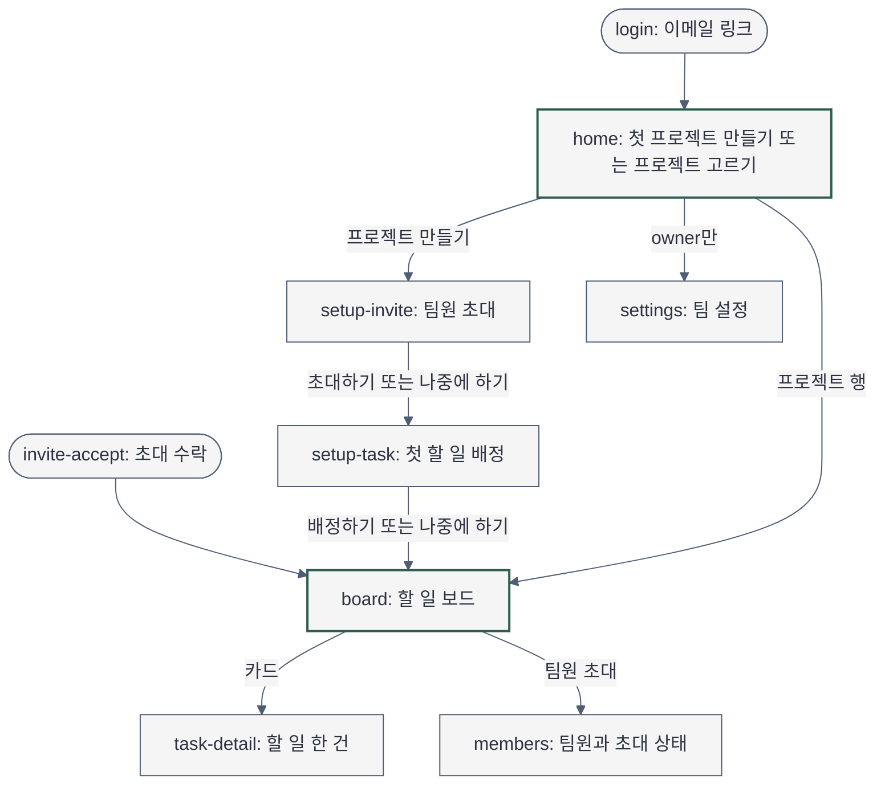
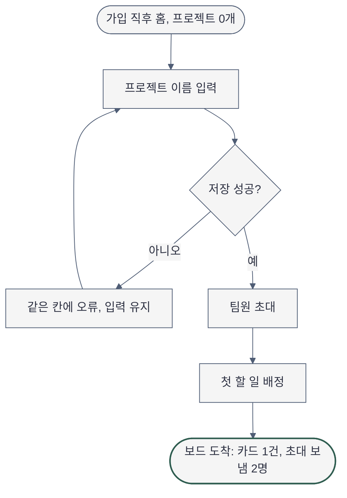

# Sitemap — 플로우보드 첫 실행 흐름

- 작성일: 2026-11-11
- 근거: [brief](2026-11-11-brief-projectflow.md), `docs/plan/projectflow/spec.md`
- 다이어그램 문법 검증: `NOT RUN` — 이 환경에 Mermaid 렌더러(`mmdc`)가 없다

## 화면 목록과 단일 임무

| ID | 경로 | 단일 임무 | 주 행동 | 누가 |
|---|---|---|---|---|
| login | `/login` | 이메일 링크로 들어온다 (기존 화면, 이번 설계 범위 밖) | 링크 받기 | 모두 |
| home | `/` | 프로젝트 0개: 첫 프로젝트를 만든다(마법사 1단계). 1개 이상: 프로젝트를 고른다 | `프로젝트 만들기` / `새 프로젝트` | owner·member |
| setup-invite | `/projects/:id/setup/invite` | 팀원을 초대한다 (2단계) | `N명 초대하기` | owner |
| setup-task | `/projects/:id/setup/task` | 첫 할 일을 배정한다 (3단계) | `배정하기` | owner |
| board | `/projects/:id` | 할 일을 보고 옮긴다 | `할 일 추가` | owner·member |
| task-detail | `/projects/:id/tasks/:taskId` | 할 일 한 건을 보고 고친다 (보드 위 패널) | 상태 바꾸기 | owner·member |
| members | `/members` | 팀원과 초대 상태를 보고 초대를 관리한다 | `팀원 초대` | owner·member |
| invite-accept | `/invite/:token` | 초대를 받아 들어온다 → 배정된 프로젝트의 board | 참여하기 | member |
| settings | `/settings` | 팀 설정 | 저장하기 | owner (member 직접 진입은 403) |

프로젝트 편집(이름 바꾸기·지우기)은 별도 페이지가 아니라 board 머리의 메뉴에서 연다(`project-settings`).

## 내비게이션

- 전역(데스크톱 좌측 사이드바): 팀 이름 → `홈` → 프로젝트 이름들(1개 이상일 때만) → `팀원` → `설정`(owner) → 맨 아래 내 이름
- 프로젝트가 0개일 때 사이드바에 프로젝트 묶음과 "프로젝트 없음" 문구를 두지 않는다. 본문이 그 답이다
- 현재 위치 신호: 사이드바 활성 항목 1개 + 본문 `h1`. 마법사 2·3단계에서는 방금 만든 프로젝트가 활성이다
- 2차 내비게이션: 마법사의 단계 표시 3개(이동 수단이 아니라 위치 표시), 모바일 보드의 열 전환 세그먼트
- 페이지 내 앵커: 없음

## 사이트맵

## 첫 실행 과업 흐름 (정상 경로와 실패 복구)

## 흐름 고리

| 대상 | Create | View | Edit | After |
|---|---|---|---|---|
| 프로젝트 | home (프로젝트 0개 모습) | board | project-settings (board 머리 메뉴) | setup-invite (만든 프로젝트 이름이 사이드바에 생기고 1단계가 완료로 바뀐 모습) |
| 팀원 초대 | setup-invite, members의 초대 창 | members | members (초대 취소·다시 보내기) | invite-sent (주소마다 `초대 보냄`이 붙은 모습) |
| 할 일 | setup-task, board의 `할 일 추가` | task-detail | task-detail (상태·담당자 바꾸기, 지우기) | board-arrived (`할 일` 열에 새 카드가 생긴 모습) |

빈 칸에서 더해진 화면: `members`(초대를 보고 고치는 곳), `task-detail`(할 일을 고치는 곳), `invite-accept`(팀원의 시작점).
