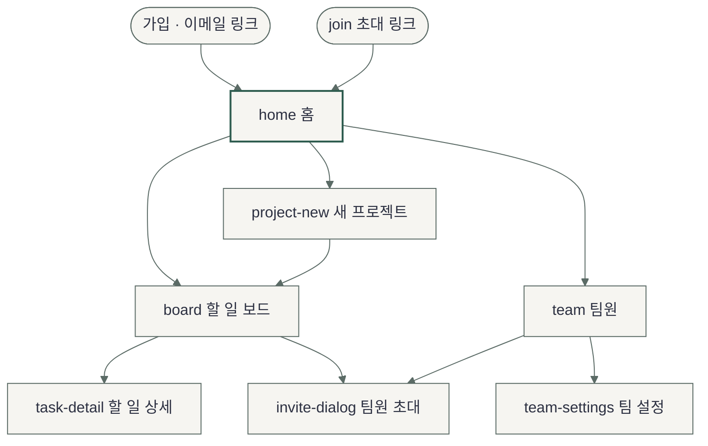
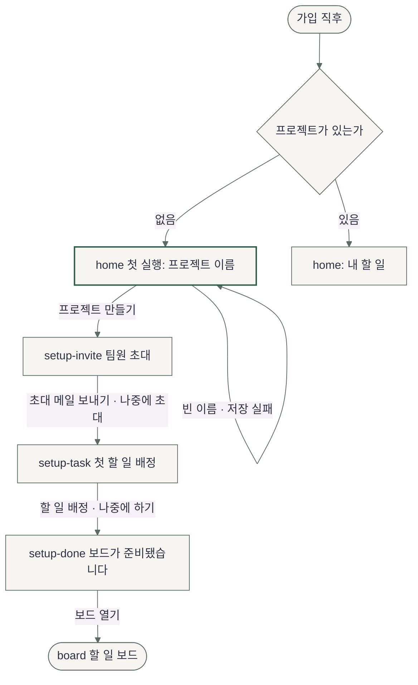

# Sitemap — 플로우보드 첫 실행 경험

- 작성일: 2026-11-11 · Phase 2-1
- 근거: `2026-11-11-brief-projectflow.md`, `docs/plan/projectflow/spec.md` 시스템 역할 표
- 화면 이름(ID)은 설계용이다. 실제 경로와 라우팅은 앱 구현 파이프라인이 정한다
- 문법: `mermaid-diagrams` 모듈의 flowchart. 렌더러로 문법을 검증하지는 않았다 (NOT RUN)

## 화면 목록과 단일 임무

| ID | 화면 | 단일 임무 | 주 행동 | 현재 위치 신호 |
|---|---|---|---|---|
| `home` (첫 실행) | 홈, 프로젝트 0개 | 첫 프로젝트를 만든다 | "프로젝트 만들기" | 내비 "홈" 활성, 단계 표시 1 |
| `home` (프로젝트 있음) | 홈 | 내 할 일을 확인하고 연다 | 내 할 일 행 열기 | 내비 "홈" 활성 |
| `setup-invite` | 시작 2단계 | 팀원을 초대하거나 넘긴다 | "N명에게 초대 메일 보내기" | 내비에 새 프로젝트 활성, 단계 표시 2 |
| `setup-task` | 시작 3단계 | 첫 할 일을 배정하거나 넘긴다 | "할 일 배정" | 단계 표시 3 |
| `setup-done` | 시작 결과 | 만든 것을 확인하고 보드로 간다 | "보드 열기" | 내비에 새 프로젝트 활성 |
| `project-new` | 새 프로젝트 | 두 번째 이후 프로젝트를 만든다 | "프로젝트 만들기" | 내비 "+ 새 프로젝트" |
| `board` | 할 일 보드 | 상태별 할 일을 보고 추가·이동한다 | "할 일 추가" | 내비에 프로젝트 활성, 제목이 프로젝트 이름 |
| `task-detail` | 할 일 상세 (보드 위 패널) | 할 일 하나를 고치고 댓글을 단다 | "저장" | 보드가 뒤에 남음 |
| `team` | 팀원 | 누가 있고 누가 초대 대기인지 본다 | "팀원 초대" (`owner`) | 내비 "팀원" 활성 |
| `invite-dialog` | 팀원 초대 (보드·팀원 화면 위 다이얼로그) | 이메일로 팀원을 초대한다 | "N명에게 초대 메일 보내기" | 연 화면이 뒤에 남음 |
| `team-settings` | 팀 설정 | 팀 이름 등 설정을 바꾼다 (`owner` 전용) | "저장" | 사용자 영역의 "팀 설정" |
| `join` | 초대 수락 | 초대 링크로 들어와 팀에 참여한다 | 없음 (자동 참여 뒤 홈) | 참여 알림 1회 |

흐름 고리를 채우며 더한 화면: `setup-done`(프로젝트·초대·할 일의 결과 화면), `invite-dialog`의 발송 완료 모습 `invite-sent`, 보드의 추가 직후 모습 `board-added`, 할 일 상세의 댓글 등록 직후 모습 `task-detail-commented`.

같은 화면이 시기에 따라 달라지는 곳은 `home` 하나다. 프로젝트 0개일 때와 있을 때를 별도 화면으로 그린다.

## 내비게이션

- 전역 (좌측 내비, 데스크톱): 플로우보드 → 홈 → 프로젝트 목록과 "+ 새 프로젝트" → 팀원 → 맨 아래 사용자 이메일·역할·"팀 설정"
- 프로젝트가 0개면 "프로젝트" 구역은 그리지 않는다. 라벨만 남아 행동도 정보도 없기 때문이다
- 2차 내비게이션: 없음. 보드는 열 3개가 한 화면에 보인다
- 페이지 내 앵커: 없음
- 좁은 화면: 상단 바(현재 위치 이름 + "메뉴")로 바꾸고 전역 내비는 "메뉴"로 연다. 프로젝트 안에서는 상단 바가 프로젝트 이름을 보여 준다
- 팀원 초대로 가는 길은 세 곳이다: 시작 2단계, 보드 머리, 팀원 화면. 설정 안에는 두지 않는다 (P2)

## 화면 구조

## 첫 실행 흐름

- 프로젝트는 1단계에서 바로 저장된다. 2·3단계에서 떠나도 프로젝트는 남고, 다음에 들어오면 `home`(프로젝트 있음)이 열린다
- `project-new`는 이름 한 칸만 받고 `setup-task` → `setup-done`으로 이어진다. 팀원이 본인뿐이면 `setup-invite`를 사이에 넣는다
- `join`에서 초대가 취소됐거나 만료됐으면 홈으로 보내지 않고, 초대한 사람에게 다시 요청하라는 안내와 "가입 화면으로" 한 가지를 보여 준다

## 흐름 고리

| 대상 | Create | View | Edit | After |
|---|---|---|---|---|
| 프로젝트 | `home` 첫 실행, `project-new` | `board` | 없음 — 상류 포함 범위에 프로젝트 고치기·지우기가 없다. Open Decisions의 scope 행 | `setup-done` |
| 팀원 초대 | `setup-invite`, `invite-dialog` | `team` | `team`의 "다시 보내기"·"초대 취소" | `invite-sent`, `setup-done` |
| 할 일 | `setup-task`, `board`의 "할 일 추가" | `board`, `task-detail` | `task-detail` (제목·담당자·마감·상태, 지우기) | `setup-done`, `board-added` |
| 댓글 | `task-detail`의 댓글 입력 | `task-detail` | 없음 — 상류에 댓글 고치기·지우기 정의가 없다 | `task-detail-commented` |

검증기가 읽는 표는 `2026-11-11-experience-projectflow.md`의 `## Object Flows`다.

## 역할별 진입

| 역할 ID | 처음 닿는 화면 | 내비에서 보이지 않는 것 |
|---|---|---|
| `owner` | `home` 첫 실행 | 없음 |
| `member` | `join` → `home`(프로젝트 있음) | "팀 설정" |

`member`가 프로젝트를 만들 수 있는지, 팀원을 초대할 수 있는지는 상류에 없어 구조 미결이다. 이 문서와 와이어프레임은 권장안(프로젝트 만들기는 표시, 팀원 초대는 숨김)으로 그렸다.
