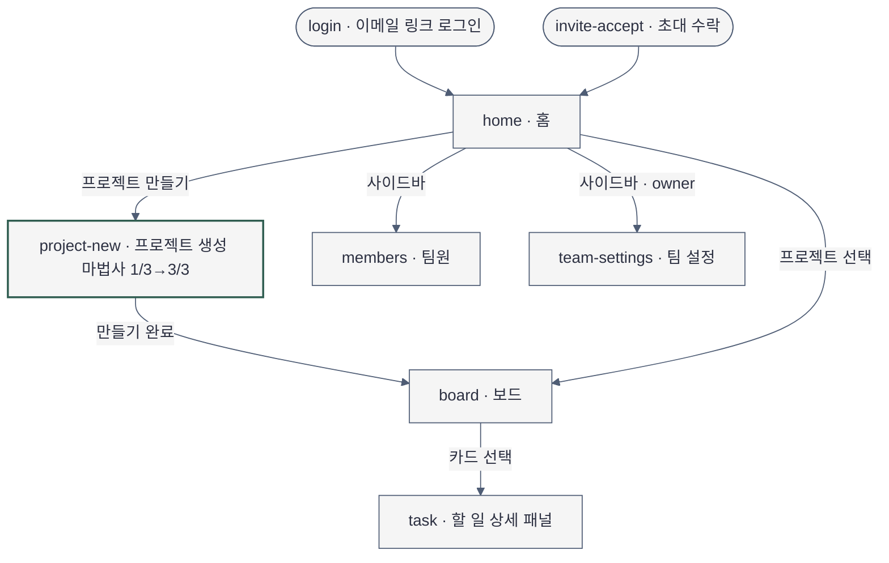

# Sitemap — 플로우보드 MVP

- 작성일: 2026-11-11
- 근거: [brief](2026-11-11-brief-projectflow.md), `docs/plan/projectflow/spec.md`
- 사이트맵 문법: `skills/mermaid-diagrams/SKILL.md`를 직접 읽어 작성. 렌더러 문법 검증은 NOT RUN.

## 화면 목록과 단일 임무

| ID | 화면 | 단일 임무 | 들어오는 사람 | 상태 |
|---|---|---|---|---|
| `login` | 로그인(이메일 링크) | 계정으로 들어간다 | owner, member | 기존. 이번 설계 범위 밖 |
| `invite-accept` | 초대 수락 | 누가 어떤 팀에 불렀는지 확인하고 참여한다 | member | 신규 |
| `home` | 홈 | 다음 한 단계를 시작하고, 만든 프로젝트로 간다 | owner, member | `Home.tsx` 스텁 → 대표 화면 |
| `project-new` | 프로젝트 생성 마법사(1/3 이름 · 2/3 팀원 초대 · 3/3 첫 할 일 배정) | 첫 보드까지 끊기지 않고 간다 | owner | 신규 |
| `board` | 보드 | 할 일을 만들고 맡기고 상태를 옮긴다 | owner, member | 신규 |
| `task` | 할 일 상세(보드 위 패널) | 할 일 하나를 고치거나 지운다 | owner, member | 신규 |
| `members` | 팀원 | 초대를 보내고 초대 상태를 본다 | owner(조작), member(보기) | 신규 |
| `team-settings` | 팀 설정 | 팀 이름 등 설정을 바꾼다 | owner | 신규. 내용은 이번 범위 밖 |

화면으로 세지 않는 것: 프로젝트 메뉴의 이름 바꾸기·보관 다이얼로그(보드를 벗어나지 않음), 팀원 화면의 초대 입력 다이얼로그,
같은 화면의 완료 모습(`board-created`, `board-task-added`, `members-invite-sent`, `home-step-done`).

## 사이트맵

## 내비게이션

- 전역(좌측 사이드바): 팀 이름 → 홈 · 팀원 · 팀 설정(owner) → 프로젝트 목록(1개 이상일 때만) → 하단 사용자.
  항목이 3개뿐이어도 anatomy 권장 수(5~7)를 채우려고 늘리지 않는다.
- 2차: 없음. 보드는 프로젝트 제목 옆 메뉴(이름 바꾸기·보관)만 둔다.
- 현재 위치 신호: 사이드바 활성 항목 1개(배경 + 굵은 글자).
- primary action: 화면마다 1개. 홈은 남은 시작 단계 중 지금 단계, 마법사는 그 단계의 진행 버튼, 팀원은 `팀원 초대`.
- 마법사는 사이드바 없이 단독 화면이며 오른쪽 위 `닫기`로 나간다. 1/3에서 닫으면 아무것도 만들지 않고 홈으로,
  2/3·3/3에서 닫으면 이미 만든 프로젝트의 보드로 간다.
- 모바일: 사이드바를 상단 바의 메뉴 버튼으로 여는 드로어로 바꾼다.

## 흐름 고리

| 대상 | Create | View | Edit | After |
|---|---|---|---|---|
| 프로젝트 | home → project-new 1/3 | board (home 프로젝트 목록에서 진입) | board 프로젝트 메뉴의 이름 바꾸기·보관 다이얼로그 | board-created (board의 프로젝트 생성 완료 상태) |
| 할 일 | board `+ 할 일 추가` 행, project-new 3/3 | board 카드 → task | task (제목·담당자·상태 고치기, 지우기) | board-task-added (board의 할 일 추가 완료 상태) |
| 팀원 초대 | project-new 2/3, members `팀원 초대` | members (초대 보냄·참여함·만료됨) | members 행의 다시 보내기·초대 취소 | members-invite-sent (members의 초대 전송 완료 상태) |

빈 칸에서 더한 화면: `invite-accept`(초대의 받는 쪽 시작점), `task`(할 일의 Edit).
