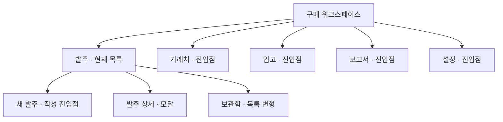
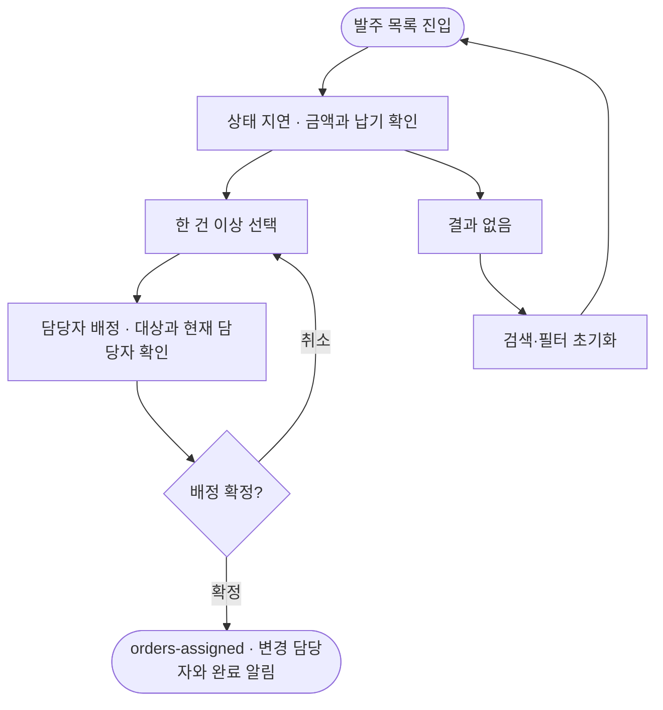

# 발주 목록 · IA와 과업 흐름

설계한 업무 화면은 **발주 목록 한 화면**이다. 모달과 결과 상태는 별도 페이지 수에 넣지 않는다. 아래 나머지 전역 메뉴는 PRODUCT.md에서 승인된 탐색 목적지이며 이번 저충실도 범위는 진입점까지다.

## 탐색

- 워크스페이스 전환과 계정은 앱 범위의 메뉴로 유지한다. 다른 워크스페이스명이나 계정 정보는 지어내지 않았다.
- 데스크톱: 워크스페이스→5개 업무 메뉴→하단 도움말·계정. ‘발주’만 활성 상태다.
- 모바일: 좌상단 앱 메뉴로 같은 전역 이동을 대체한다. 새 발주는 화면 제목과 같은 행에 유지한다.
- 목록 더보기: CSV 내보내기·보관함·도움말, 폰에서는 새로고침도 수용한다.
- 행 더보기: 상세 열기·담당자 변경·보관. 발주번호 링크로도 상세를 연다.

## 주 과업과 오류 회복

확정 오류에서는 모달·선택·담당자 입력을 보존하고 재시도를 제공하는 계약이다. 조회 실패는 기존 결과와 조건을 보존하고 ‘다시 시도’, 최신성 확인 실패는 ‘새로고침’, 권한 확인 실패는 ‘다시 확인’으로 돌아온다. 실제 서버 실패·저장 충돌은 연결하지 않으며 상태 시트로 구조를 전달한다.

## 화면과 상태의 임무

| 화면·상태 | 단일 임무 | 돌아가는 곳 |
|---|---|---|
| 발주 목록 | 조건을 좁히고 비교·선택 | 현재 조건 그대로 |
| 담당자 배정 모달 | 대상과 담당자 확인 후 확정 | 취소: 선택 목록, 성공: orders-assigned |
| 발주 상세 모달 | 선택한 한 발주의 7개 필드 확인 | 목록 또는 담당자 변경 |
| orders-assigned | 변경 대상과 결과 확인 | 같은 목록, 선택 해제 |
| 보관함 | 보관한 발주 확인 | 목록 더보기 → 발주 목록 |
| 결과 없음·오류 | 조건 수정·재시도 | 검색 또는 같은 조건 결과 |

Mermaid 문법은 로컬 모듈의 flowchart 규칙으로 작성했다. 렌더러 설치·문법 실행 검증은 NOT RUN — 외부 패키지 설치를 하지 않는다.
