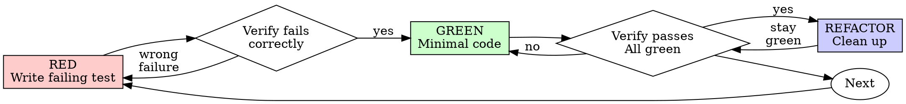

# Test-Driven Development (TDD)

## Invocation and Resource Paths

This module is source-only by default and applies when the user explicitly requests
TDD or test-first development. Do not assume its slash command is registered.
Resolve its exact `SKILL.md` from the project, the current runtime's active skill root,
then the matching `SKILLS-CATALOG.md` row. `module_root` is the directory containing
that file; read supporting documents relative to it, regardless of the project working directory.

## Overview

Write the test first. Watch it fail. Write minimal code to pass.

**Core principle:** If you didn't watch the test fail, you don't know if it tests the right thing.

## Step 0: 프로젝트 테스트 계약 확인

README·manifest·lockfile·테스트 설정·CI와 인접 테스트에서 실제 실행 명령을 확인한다.
기존 package script나 wrapper를 우선하고, 파일 이름만 보고 runner를 단정하지 않는다.
모노레포의 작업 디렉터리·패키지 선택·단일 테스트 필터와 필수 전체 검사를 구분한다.
테스트 위치·이름도 기존 관례를 따른다. 아래 `npm test` 예시는 확인한 프로젝트 명령으로 바꾼다.
실행 환경이 없으면 `NOT RUN`과 필요한 조건을 기록하고, 쓰기나 정적 확인을 테스트 통과로 보고하지 않는다.

## The Iron Law

```
NO PRODUCTION CODE WITHOUT A FAILING TEST FIRST
```

This governs new behavior in the authorized change. Preserve existing production code,
user edits, and other workers' changes. If this experiment's implementation was written
first, record the missed RED step and restore only its own changes to a known baseline
before replaying the cycle. Never reset a file or delete existing work merely to satisfy TDD.
For existing behavior, characterization tests may pass immediately; label them as such
and separately demonstrate that a regression test detects the defect being fixed.

## Red-Green-Refactor



### RED - Write Failing Test

Write one minimal test showing what should happen.

<Good>
```typescript
test('retries failed operations 3 times', async () => {
  let attempts = 0;
  const operation = () => {
    attempts++;
    if (attempts < 3) throw new Error('fail');
    return 'success';
  };

  const result = await retryOperation(operation);

  expect(result).toBe('success');
  expect(attempts).toBe(3);
});
```
Clear name, tests real behavior, one thing
</Good>

<Bad>
```typescript
test('retry works', async () => {
  const mock = jest.fn()
    .mockRejectedValueOnce(new Error())
    .mockRejectedValueOnce(new Error())
    .mockResolvedValueOnce('success');
  await retryOperation(mock);
  expect(mock).toHaveBeenCalledTimes(3);
});
```
Vague name, tests mock not code
</Bad>

**Requirements:**
- One behavior
- Clear name
- Real code (no mocks unless unavoidable)

### Verify RED - Watch It Fail

**MANDATORY. Never skip.**

```bash
npm test path/to/test.test.ts
```

Confirm:
- Test fails (not errors)
- Failure message is expected
- Fails because feature missing (not typos)

**Test passes?** Check whether it exercises existing behavior or misses the intended change;
do not change an expectation merely to force a failure.

**Test errors?** Fix error, re-run until it fails correctly.

### GREEN - Minimal Code

Write simplest code to pass the test.

<Good>
```typescript
async function retryOperation<T>(fn: () => Promise<T>): Promise<T> {
  for (let i = 0; i < 3; i++) {
    try {
      return await fn();
    } catch (e) {
      if (i === 2) throw e;
    }
  }
  throw new Error('unreachable');
}
```
Just enough to pass
</Good>

<Bad>
```typescript
async function retryOperation<T>(
  fn: () => Promise<T>,
  options?: {
    maxRetries?: number;
    backoff?: 'linear' | 'exponential';
    onRetry?: (attempt: number) => void;
  }
): Promise<T> {
  // YAGNI
}
```
Over-engineered
</Bad>

Don't add features, refactor other code, or "improve" beyond the test.

### Verify GREEN - Watch It Pass

**MANDATORY.**

```bash
npm test path/to/test.test.ts
```

Confirm:
- Test passes
- Required project checks and affected regression tests pass
- Output and exit codes have been reviewed; relevant warnings and failures are reported

**Test fails?** Fix code, not test.

**Other tests fail?** Check whether the change caused them. Fix regressions within scope
and report pre-existing or external failures explicitly. Reuse valid evidence for unchanged
code and conditions; repeat checks when changes, failures, or unresolved doubts justify it.

### REFACTOR - Clean Up

After green only:
- Remove duplication
- Improve names
- Extract helpers

Keep tests green. Don't add behavior.

### Repeat

Next failing test for next feature.

## Good Tests

| Quality | Good | Bad |
|---------|------|-----|
| **Minimal** | One thing. "and" in name? Split it. | `test('validates email and domain and whitespace')` |
| **Clear** | Name describes behavior | `test('test1')` |
| **Shows intent** | Demonstrates desired API | Obscures what code should do |

## Evidence Gaps

- A passing test alone does not prove it would catch the intended defect. Identify the
  behavior change that should make it fail, then demonstrate RED on the relevant baseline.
- An import, setup, or environment error is not the intended RED result. Resolve the
  prerequisite and verify the behavioral failure before implementation.
- Tests that only mirror the implementation or assert on mock calls may miss the user-visible
  contract. Assert on observable outcomes and meaningful boundaries.
- Record deviations from the requested cycle honestly. Do not fabricate a RED run, weaken
  expectations, or discard unrelated work to make the process appear compliant.

## Example: Bug Fix

**Bug:** Empty email accepted

**RED**
```typescript
test('rejects empty email', async () => {
  const result = await submitForm({ email: '' });
  expect(result.error).toBe('Email required');
});
```

**Verify RED**
```bash
$ npm test
FAIL: expected 'Email required', got undefined
```

**GREEN**
```typescript
function submitForm(data: FormData) {
  if (!data.email?.trim()) {
    return { error: 'Email required' };
  }
  // ...
}
```

**Verify GREEN**
```bash
$ npm test
PASS
```

**REFACTOR**
Extract validation for multiple fields if needed.

## Verification Checklist

Before marking work complete:

- [ ] Each changed behavior has a meaningful test
- [ ] Watched each test fail before implementing
- [ ] Each test failed for expected reason (feature missing, not typo)
- [ ] Wrote minimal code to pass each test
- [ ] Required checks pass; failures and unexecuted checks are named
- [ ] Commands, code/environment identity, exit codes, and relevant output are recorded
- [ ] Tests use real code (mocks only if unavoidable)
- [ ] Edge cases and errors covered

Report missing evidence and complete the relevant step; do not claim the full cycle ran
or restart unrelated work to satisfy this checklist.

## When Stuck

| Problem | Solution |
|---------|----------|
| Don't know how to test | Write wished-for API. Write assertion first. Ask your human partner. |
| Test too complicated | Design too complicated. Simplify interface. |
| Must mock everything | Code too coupled. Use dependency injection. |
| Test setup huge | Extract helpers. Still complex? Simplify design. |

## Debugging Integration

Bug found? Write failing test reproducing it. Follow TDD cycle. Test proves fix and prevents regression.

Never fix bugs without a test.

## Testing Anti-Patterns

When adding mocks or test utilities, read [testing-anti-patterns.md](testing-anti-patterns.md)
under `module_root` to avoid common pitfalls:
- Testing mock behavior instead of real behavior
- Adding test-only methods to production classes
- Mocking without understanding dependencies

## Final Rule

```
Production code → test exists and failed first
Otherwise → not TDD
```

No exceptions without your human partner's permission.
